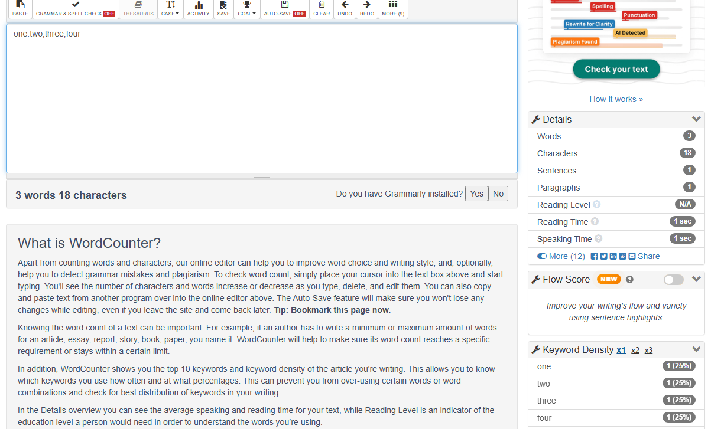
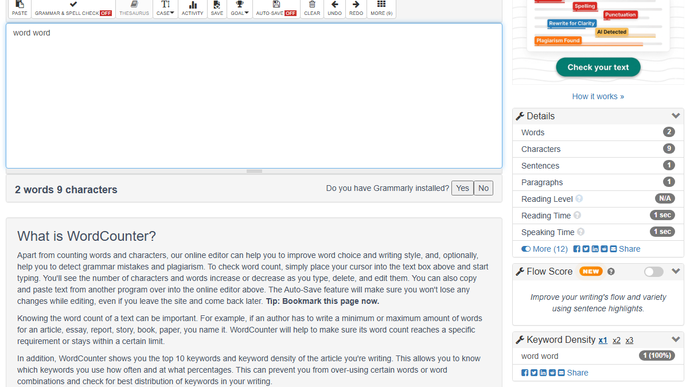
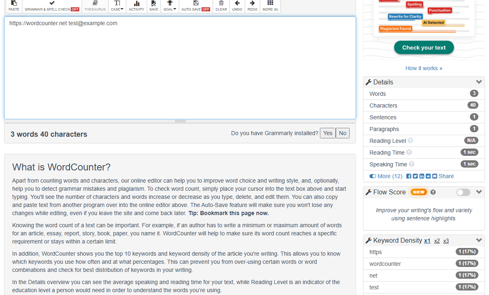

# Reporte de bugs: wordcounter.net

|                     |                                                                                                                                     |
| ------------------- | ----------------------------------------------------------------------------------------------------------------------------------- |
| **Sitio**           | https://wordcounter.net (configuración por defecto)                                                                                 |
| **Fecha**           | 15/10/2026                                                                                                                          |
| **Entorno**         | Windows 11 Pro · Chromium 156 (Playwright 1.64) · desktop 1280×900                                                                  |
| **Alcance probado** | Número de palabras, número de caracteres y top 3 de Keyword Density (modo x1)                                                       |
| **Detectado por**   | Suite automatizada de este repo ([`tests/e2e/keyword-density.spec.ts`](../tests/e2e/keyword-density.spec.ts), escenarios `@defect`) |

## Resumen

Se encontraron **3 bugs**. Los tres tienen la **misma causa de fondo**: el contador de palabras y el panel Keyword Density separan el texto en palabras con reglas distintas. Para un mismo texto, la página muestra dos datos que se contradicen.

| ID                                                                                                  | Título                                                                            | Severidad | Prioridad |
| --------------------------------------------------------------------------------------------------- | --------------------------------------------------------------------------------- | --------- | --------- |
| [BUG-01](#bug-01-la-puntuación-sin-espacios-se-cuenta-distinto-en-el-contador-y-en-keyword-density) | La puntuación sin espacios se cuenta distinto en el contador y en Keyword Density | Media     | Media     |
| [BUG-02](#bug-02-el-espacio-de-no-separación-nbsp-une-dos-palabras-en-keyword-density)              | El espacio de no separación (NBSP) une dos palabras en Keyword Density            | Media     | Media     |
| [BUG-03](#bug-03-urls-y-emails-cuentan-como-1-palabra-pero-keyword-density-los-parte)               | URLs y emails cuentan como 1 palabra, pero Keyword Density los parte              | Baja      | Baja      |

**Criterio de severidad**

- **Media:** un dato visible está mal en un caso de uso frecuente, como pegar texto de otra aplicación.
- **Baja:** el dato es incorrecto, pero en un caso menos frecuente o con poco impacto en el uso principal.

En ningún caso se rompe la página ni se pierde texto.

### Cómo se verificó

- **Con un pegado real:** cada bug se reprodujo pegando el texto con `Ctrl+V`, como lo haría un usuario. La evidencia de abajo se capturó así.
- **Sin publicidad:** durante las pruebas se bloquearon los scripts de publicidad y analytics, que no forman parte del contador.
- **Sin tocar la configuración:** no se modificó ninguna opción del sitio. Keyword Density estaba en modo **x1**, con el top 10 y las stop words excluidas.

---

## BUG-01: La puntuación sin espacios se cuenta distinto en el contador y en Keyword Density

| Campo                 | Detalle                                                                                                                      |
| --------------------- | ---------------------------------------------------------------------------------------------------------------------------- |
| **Severidad**         | Media                                                                                                                        |
| **Prioridad**         | Media                                                                                                                        |
| **Componente**        | Contador de palabras / Keyword Density                                                                                       |
| **Reproducibilidad**  | Siempre (100%)                                                                                                               |
| **Test automatizado** | `Keyword Density › defectos detectados › coincide con el contador de palabras: puntuación sin espacios (one.two,three;four)` |

**Pasos para reproducir**

1. Abrir https://wordcounter.net.
2. Pegar en el editor el texto: `one.two,three;four`

**Resultado esperado**

El contador de palabras y Keyword Density coinciden en la cantidad de palabras:

- si se separa por la puntuación: 4 palabras y 4 keywords;
- si no se separa: 1 palabra y 1 keyword.

**Resultado actual**

| Dato                 | Valor                                                                                     |
| -------------------- | ----------------------------------------------------------------------------------------- |
| Contador de palabras | **3 words**                                                                               |
| Keyword Density      | `one` 1 (25%) · `two` 1 (25%) · `three` 1 (25%) · `four` 1 (25%), es decir **4 palabras** |

El contador no aplica una regla uniforme: separa en `.` pero no en `,`, o al revés. Keyword Density, en cambio, separa en todos los signos. Además, los porcentajes (25% cada una) se calculan sobre 4 palabras mientras el contador muestra 3.

**Evidencia**

**Impacto**

Los textos con errores de tipeo (falta el espacio después del punto o la coma) son comunes. Quien usa la herramienta para cumplir un límite de palabras ve un número que no coincide con el análisis de keywords de la misma página.

---

## BUG-02: El espacio de no separación (NBSP) une dos palabras en Keyword Density

| Campo                 | Detalle                                                                                                         |
| --------------------- | --------------------------------------------------------------------------------------------------------------- |
| **Severidad**         | Media                                                                                                           |
| **Prioridad**         | Media                                                                                                           |
| **Componente**        | Keyword Density                                                                                                 |
| **Reproducibilidad**  | Siempre (100%)                                                                                                  |
| **Test automatizado** | `Keyword Density › defectos detectados › coincide con el contador de palabras: espacio de no separación (NBSP)` |

**Pasos para reproducir**

1. Abrir https://wordcounter.net.
2. Pegar en el editor el texto `word word`, con un **espacio de no separación** (U+00A0) entre las dos palabras en lugar de un espacio común.

   > Este carácter aparece con frecuencia al copiar texto de Word, Google Docs o páginas web (`&nbsp;`). Para generarlo en Windows: `Alt + 0160`.

**Resultado esperado**

El NBSP es un espacio, así que separa palabras:

- Contador: **2 words**
- Keyword Density: `word` **2 (100%)**

**Resultado actual**

| Dato                 | Valor                                                                        |
| -------------------- | ---------------------------------------------------------------------------- |
| Contador de palabras | **2 words** ✔️                                                               |
| Keyword Density      | `word word` **1 (100%)**: toma las dos palabras como **una sola keyword** ❌ |

**Evidencia**

**Impacto**

Es el bug con más impacto real: el texto pegado desde editores y páginas web suele traer NBSP. Las palabras afectadas desaparecen del ranking o aparecen como keywords falsas ("word word"). Así, el top 3, que es justamente lo que se usa para analizar la densidad de keywords, queda mal.

---

## BUG-03: URLs y emails cuentan como 1 palabra, pero Keyword Density los parte

| Campo                 | Detalle                                                                                     |
| --------------------- | ------------------------------------------------------------------------------------------- |
| **Severidad**         | Baja                                                                                        |
| **Prioridad**         | Baja                                                                                        |
| **Componente**        | Contador de palabras / Keyword Density                                                      |
| **Reproducibilidad**  | Siempre (100%)                                                                              |
| **Test automatizado** | `Keyword Density › defectos detectados › coincide con el contador de palabras: URL y email` |

**Pasos para reproducir**

1. Abrir https://wordcounter.net.
2. Pegar en el editor el texto: `https://wordcounter.net test@example.com`

**Resultado esperado**

Ambos componentes aplican el mismo criterio:

- si una URL o un email es una palabra: 2 palabras y 2 keywords;
- si se separa en partes: el mismo número en los dos.

**Resultado actual**

| Dato                 | Valor                                                                                                   |
| -------------------- | ------------------------------------------------------------------------------------------------------- |
| Contador de palabras | **3 words** (no coincide con ninguno de los dos criterios)                                              |
| Keyword Density      | `https` · `wordcounter` · `net` · `test` · `example` · `com`, 1 (17%) cada una, es decir **6 palabras** |

**Evidencia**

**Impacto**

Bajo para el uso general. Para contenido técnico o de marketing, que suele incluir enlaces y emails, Keyword Density muestra fragmentos como `https`, `com` o `net`, que no aportan nada y pueden desplazar keywords reales del top.

---

## Caso de control

Para descartar que el problema sea la puntuación en general, se probó un texto con puntuación normal (seguida de espacio). Ahí ambos componentes coinciden:

`Hello world. Nice day, nice code!` → **6 words**, y Keyword Density suma 6 (`nice` 2 · `hello` 1 · `world` 1 · `day` 1 · `code` 1).

## Causa probable y recomendación

Los tres bugs apuntan a que el contador de palabras y Keyword Density usan **dos tokenizadores distintos**:

| Separador                                        | Contador de palabras      | Keyword Density |
| ------------------------------------------------ | ------------------------- | --------------- |
| Espacio común, tab, salto de línea               | separa                    | separa          |
| Espacio de no separación (U+00A0)                | separa                    | **no separa**   |
| Puntuación sin espacio (`.` `,` `;` `:` `/` `@`) | separa solo algunos casos | separa siempre  |

**Recomendación:** usar **una única función de tokenización** para los dos componentes y definir explícitamente:

- que todo carácter de espacio Unicode (`\s` con soporte Unicode, incluido U+00A0) separa palabras;
- qué hacer con la puntuación sin espacio, con URLs y con emails.

Con eso se resuelven los 3 bugs y se evitan regresiones futuras. Los tests `@defect` de este repo sirven como pruebas de regresión: van a pasar cuando el comportamiento sea consistente.

## Observaciones (no reportadas como bug)

Comportamientos que llaman la atención, pero que son decisiones de producto o configuración, y no errores:

- **Stop words poco obvias:** la lista por defecto excluye palabras como `ruby` y `river`, que no son palabras vacías habituales. Puede sorprender a un usuario, pero es configurable desde las opciones del sitio.
- **Números fuera de Keyword Density:** los números cuentan como palabras en el contador, pero no aparecen en Keyword Density.
- **Saltos de línea:** no cuentan como caracteres. Se tomó como regla de negocio.
